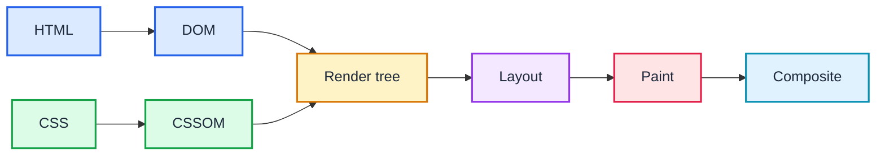

# From source to pixels

- **Parse:** HTML and CSS become the DOM and CSSOM.
- **Render:** The browser determines what to display and calculates its geometry.
- **Draw:** Painting and compositing produce the final pixels.

<!--
- Explain that the browser does not render HTML source code directly.
- The HTML parser constructs the DOM, representing the document's structure.
- The CSS parser constructs the CSSOM, representing parsed CSS rules.
- Style computation uses the DOM and CSS information to determine computed styles.
- The render tree represents renderable content with its computed styles. It is not an exact copy of the DOM.
- Layout calculates the dimensions and positions of rendered objects.
- Paint produces drawing instructions for visual properties such as text, backgrounds, borders, and shadows.
- Compositing combines the relevant painted layers and produces the final displayed result.
- This is a simplified conceptual pipeline. Browsers may optimize, skip, or overlap stages.
- Ask participants: Does changing the color of an element require recalculating its position?
- Explain that a color change generally requires painting but not layout, while a geometry change may require layout and subsequent stages.
-->
